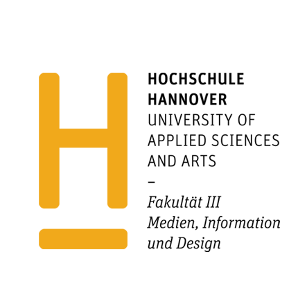
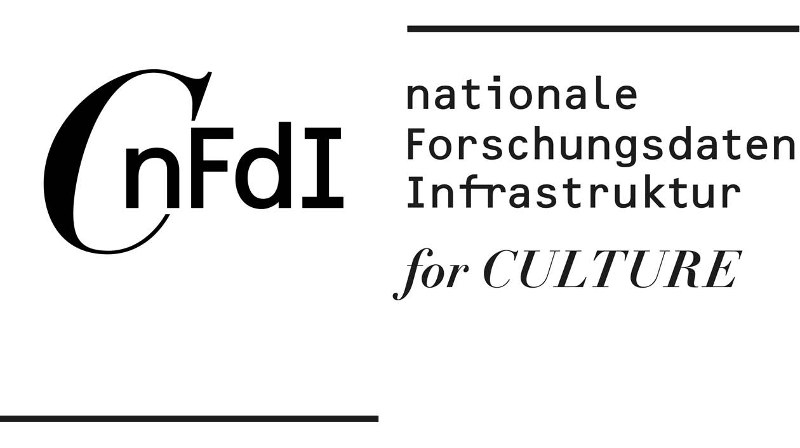
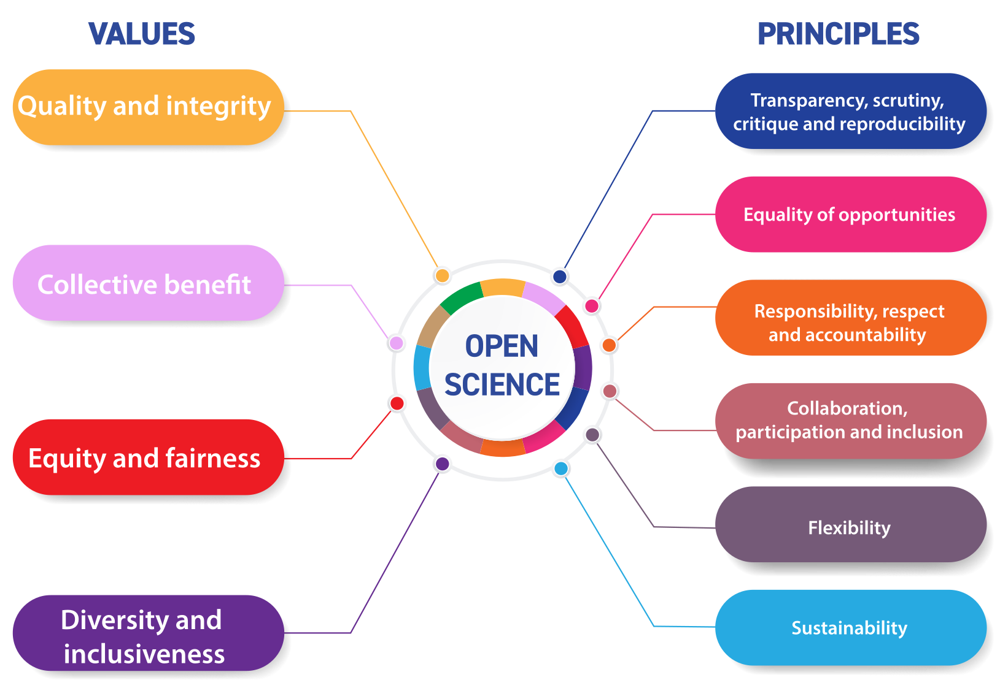
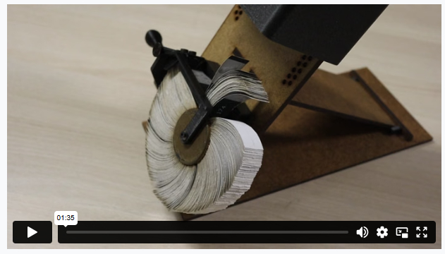

## Context {.smaller}

- Projects:
  - [Computational Publishing Service](https://nfdi4culture.de/services/details/computational-publishing-service.html) (CPS) as part of [OSL Wikibase Data Services](https://service.tib.eu/wikibase-data)
  - [ClimateKG](https://www.tib.eu/en/research-development/project-overview/project-summary/climatekg) - A knowledge graph for climate science literature - initially launching with the IPCC Sixth Assessment Report (AR6) 

Affiliations: Teaching Data Science in a GLAM context at University of the Applied Arts Hannover (HsH); R&D section Open Science Lab, service development - TIB; Carrying out research and service provision as parts of NFDI4Culture

::: {style="text-align: center; margin-top: 20px;"}

  
  
  

:::

---

## Computational Publishing History {.smaller} 

::: {style="text-align: center; margin-top: 16px;"}
{fig-alt="Paul Otlet portrait" width="70%"}
:::

Volunteers worked at the Universal Bibliographic Repertory, the project that grew into the Mundaneum (1905) 

::: aside
\ Monoskop page for Paul Otlet: [https://monoskop.org/Paul_Otlet](https://monoskop.org/Paul_Otlet)
:::

---

## Paul Otlet - Mundaneum {.smaller}

::::: columns
::: {.column width="50%"}

:::

::: {.column width="30%"}

:::
::::: 

::: aside
[Mundaneum](https://www.mundaneum.org/en) | Paul Otlet 1934 | Text of Twain: [King Leopold's Soliloquy (Project Gutenberg)](https://www.gutenberg.org/ebooks/62739) 1905 | Reworking by Elisabetta Benassi: King Leopold's Soliloquy - [Nero Editions](https://www.neroeditions.com/product/king-leopolds-soliloquy-by-mark-twain/) 2025, 978-88-97503-60-6 | Another look at a Knowledge Organization pioneer: traces of
racism in Paul Otlet’s writings [HAL](https://hal.science/hal-04460850)
::: 

---

## CP History Continued {.smaller}

::::: columns
::: {.column width="50%"}
#### Memex 1945

#### Dynabook 1973 

:::

::: {.column width="50%"}
####  Xanadu 1960 

#### Semantic Web 1994

:::
:::::

::: aside
Wikipedia: [Memex](https://en.wikipedia.org/wiki/Memex) | [Project Xanadu](https://en.wikipedia.org/wiki/Project_Xanadu) | [Dynabook](https://en.wikipedia.org/wiki/Dynabook) | [Semantic Web](https://en.wikipedia.org/wiki/Semantic_Web)
:::

---

## Open Scholarship Values and Infra {.smaller}

::: {style="text-align: center;"}
  
:::

::: aside
Image credit: [UNESCO Recommendation on Open Science](https://unesdoc.unesco.org/ark:/48223/pf0000379949) pp17 
:::
---

## Open Scholarship Values and Infra {.smaller}

::: {style="text-align: center;"}

:::

Computational Publishing techstack: Jupyter Notebooks, Git, Quarto

::: aside
Image credit: SCOSS, [https://scoss.org/](https://scoss.org/) 
:::
---

## CP in Sciences and GLAM {.smaller}

::: {style="text-align: center;"}
CP as the exception and not the rule
:::

::::: columns
::: {.column width="50%"}
- **[TIB Knowledge Loom](https://knowledgeloom.tib.eu/) (reborn)**

Digital library ORKG reborn

  
:::

::: {.column width="50%"}
- **[Journal of Digital History](https://doi.org/10.1515/JDH-2021-1009?locatt=label:JDHFULL)** 

Replicating the Kinora: 3D modelling and printing as heuristics in digital media history

  

:::
:::::

::: aside
[Reborn article](https://www.nature.com/articles/s41597-025-04905-0) - Co-author Lauren Snyder: “[Dance your PhD](https://youtu.be/lM0OolYmD9c?si=XM7iyzT6UF_rL-FM)” | van der Heijden, T., & Wolf, C. (2022).[https://doi.org/10.1515/JDH-2021-1009?locatt=label:JDHFULL](https://doi.org/10.1515/JDH-2021-1009?locatt=label:JDHFULL)
::: 

---

## Thank You :-) {.smaller style="font-size: 0.7em;"}

---

## Computational Publishing: Workshop Hands-on Session

> * Prototype: Linked Open Exhibition

Art exhibitions currently don't make public records of what artworks are displayed. The project aims to support curators in creating a linked open dataset of exhibition records and prouce data driven catalogue publications.  

---

## Hands-on Session {.smaller}

_Prototype:_ Convert data from an OCR scan of a catalogue of works by the artist John Baldessari shown in an art exhibition at the Sprengel Museum Hannover 26.9.1999 - 2.1.2000 into a data driven publication. 

- Making Linked Open Data entries in Wikidata
- Using Jupyter Notebooks
- Data standards for art exhibitions
- Publishing an exhibition catalogue

::: aside
Go here: [https://nfdi4culture.github.io/John-Baldessari-Exhibition-Catalogue/](https://nfdi4culture.github.io/John-Baldessari-Exhibition-Catalogue/)
:::  

---

## Workflow Schematic {.smaller}

::: {style="text-align: center;"}
<pre style="display: inline-block; text-align: left; background: transparent; border: none; box-shadow: none; margin: 0; padding: 0; font-size: 0.78em; line-height: 1.15; font-family: 'Courier New', Consolas, monospace;">
+----------------+      +----------------+
|      BOOK      |----->|      OCR       |
+--------+-------+      +--------+-------+
                                  
         v --------------------- |
                                
+----------------+      +----------------+
|    DATASET     |----->|    WIKIDATA    |
+--------+-------+      +--------+-------+
                                  
         v --------------------- |
+----------------+      +----------------+
|  PUBLICATION   |----->|    DEPOSIT     |
|                |      |  (Mint PIDs)   |
+----------------+      +----------------+
</pre>
:::

---

## Info and credits {.smaller}

Catalogue of works by the artists John Baldessari shown in an art exhibition at the Sprengel Museum Hannover 26.9.1999 - 2.1.2000. The purpose of the prototype is to demonstrate how to catalogue artworks in an exhibition as Linked Open Data on Wikidata. In this instance an OCR scan is transfered to Wikidata and then ouput as a computationally reproducible Quarto publication.

OCR workflow: Chloë Farr, orcid: 0009-0007-1146-6745

Concept and execution: Simon Worthington, orcid: 0000-0002-8579-9717

Thank you to the students of the Bachelor of Arts Information Management at Hochschule Hannover in the course [BIM-126-02 Data Science](https://www.hs-hannover.de/studium/studienangebot/bachelor/information-management/) (SoSe 2026)

Contact: simon.worthington@tib.eu 

